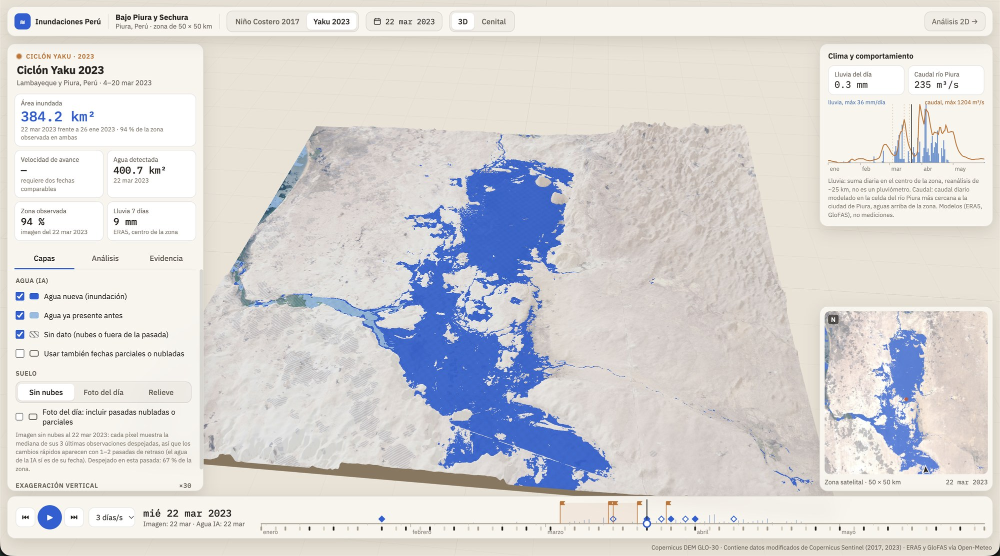

# Mapeo de inundaciones en Perú con modelos fundacionales geoespaciales

*English version: [README.md](README.md).*

Tesis de maestría, Maestría en Ciencias con mención en Inteligencia Artificial, Universidad
Nacional de Ingeniería (UNI). Autores: Gerson Andre Garrido Mansilla, Renzo Elvis Cerron Tome.
La tesis está escrita en español; el resto de la documentación del repositorio está en inglés.

**Pregunta.** La segmentación de la extensión de inundaciones en imágenes Sentinel-2 obtiene
buenos resultados en el conjunto de referencia estándar (Sen1Floods11), pero nadie la ha
evaluado en Perú. En esta tesis:
- se comparan dos modelos fundacionales geoespaciales Transformer (TerraMind v1-B,
  Prithvi-EO-2.0 300M) con una U-Net;
- se construye un conjunto de datos etiquetado de inundaciones en Perú a partir de mapas
  expertos, sin etiquetado manual;
- se mide dónde fallan los modelos en Perú y por qué;
- se adaptan a Perú modelos entrenados en Sen1Floods11, sin etiquetas de Perú.

Las preguntas de investigación y las fases están en [`docs/PLAN.md`](docs/PLAN.md).

## Datos

| Conjunto | Fuente | Uso |
|---|---|---|
| Sen1Floods11 etiquetado a mano, Sentinel-2 L1C, 13 bandas | Bonafilia et al. 2020 | particiones oficiales (train 252 / valid 89 / test 90); nunca se vuelven a particionar |
| Perú 2023 (ciclón Yaku, Lambayeque y Piura) | mapas expertos de inundación de UNOSAT → etiquetas automáticas sobre recortes de Sentinel-2 | `peru-train` (753), `peru-dev` (174), `peru-test` (172), partición espacial |
| Perú 2017 (Niño Costero) | mapas EMSR199 de Copernicus EMS | `peru-2017-test` (204 recortes) |

La ficha de datos es [`docs/peru_data_card.md`](docs/peru_data_card.md). Ni los datos ni los
*checkpoints* están en el repositorio (git ignora `data/` y `outputs/`). Se reconstruyen con
`scripts/download_sen1floods11.py`, `scripts/build_peru_unosat.py` y
`scripts/build_peru_emsr2017.py`. Los scripts de construcción de Perú descargan las imágenes con la Process API del Copernicus Data Space (CDSE) y necesitan credenciales de CDSE, que
leen de variables de entorno.

## Protocolo

- Los modelos se seleccionan solo con `valid` de Sen1Floods11 y con `peru-dev`.
- Los conjuntos de prueba (`test`, `peru-test`, `peru-2017-test`) se evalúan **una sola vez**, a
  partir de configuraciones congeladas con los hashes de sus *checkpoints* en
  [`configs/frozen.yaml`](configs/frozen.yaml).
  [`scripts/evaluate_frozen.py`](scripts/evaluate_frozen.py) se niega a ejecutarse en cualquier
  otro caso.
- Al menos 3 semillas por configuración, reportadas como media ± desviación estándar. Cada
  modelo usa su normalización de entrada oficial.
- Cada ejecución se registra con su commit en [`docs/EXPERIMENT_LOG.md`](docs/EXPERIMENT_LOG.md).
  Cada decisión de método, verificación y corrección queda fechada en
  [`docs/METHODS_NOTES.md`](docs/METHODS_NOTES.md).

## Resultados hasta ahora

Informes detallados:

| Tema | Documento |
|---|---|
| Fase D (adaptación sin etiquetas de Perú) en `peru-dev` | [`docs/phaseD_dev.md`](docs/phaseD_dev.md) |
| Evaluación única en los conjuntos de prueba | [`docs/phaseD_test.md`](docs/phaseD_test.md) |
| Análisis de fallos | [`docs/failure_analysis_dev.md`](docs/failure_analysis_dev.md) |
| Cambio de dominio | [`docs/domain_shift_dev.md`](docs/domain_shift_dev.md) |
| Calibración e incertidumbre | [`docs/calibration_dev.md`](docs/calibration_dev.md), [`docs/uncertainty_dev.md`](docs/uncertainty_dev.md) |
| Ingeniería de características | [`docs/feature_engineering.md`](docs/feature_engineering.md) |

Resultado principal de `docs/phaseD_test.md`:

- **Evento de 2023 (`peru-test`).** La U-Net entrenada en Sen1Floods11 con igualación de
  histogramas hacia imágenes de Perú sin etiquetas alcanza 0.798 ± 0.005 de IoU de agua.
  - Queda 0.030 por debajo de la U-Net entrenada en Perú (0.828) y 0.22 por encima de la U-Net
    sin adaptar (0.576).
  - Es el mejor resultado sin etiquetas de Perú.
- **Evento de 2017 (`peru-2017-test`).** El orden se invierte: los modelos sin adaptar obtienen
  los mejores resultados.
  - Las etiquetas de 2017 solo miden el *recall* de agua clara.
  - La adaptación sacrifica *recall* de agua tenue a cambio de menos falsos positivos del
    desierto, por lo que aquí obtiene un resultado menor.
  - Ningún método gana en ambos eventos.

## Aplicación de análisis de inundaciones

Una aplicación web (objetivo 3 de la tesis) procesa una tesela (*tile*) completa de Sentinel-2
de CDSE con la U-Net entrenada en Perú. Muestra:
- el mapa de agua, la incertidumbre del modelo y las nubes;
- el área inundada respecto a una imagen previa al evento;
- la concordancia con los mapas expertos de UNOSAT y EMS.

También exporta GeoTIFF y GeoJSON. La vista 3D del incidente que aparece abajo cubre el Bajo
Piura y Sechura. Combina el agua detectada por la IA en cada fecha, una línea de tiempo de fotos
de Sentinel-2 de 2017 y 2023, la lluvia y el caudal de los ríos, y las fechas clave del evento.



Código: `src/floodseg/system/` (backend en FastAPI) y `app/` (React, MapLibre y Three.js). Cómo
ejecutarla: [`app/README.md`](app/README.md).

## Estructura del repositorio

| Ruta | Contenido |
|---|---|
| `src/floodseg/` | Biblioteca: conjuntos de datos, normalización, métricas, alineación de la entrada (igualación de histogramas, FDA), AdaBN, autoentrenamiento |
| `configs/` | Configuraciones de los modelos en TerraTorch; `frozen.yaml` (congelamiento previo a la evaluación de prueba); *pools* |
| `scripts/` | Construcción de datos, utilidades de entrenamiento, análisis, evaluación congelada y cálculo de métricas; `scripts/cloud/` contiene las utilidades para RunPod |
| `src/floodseg/system/` | Sistema de análisis de inundaciones: descarga desde CDSE, inferencia sobre la tesela completa, métricas frente a la referencia, área inundada, exportación, servidor FastAPI |
| `app/` | Aplicación web (React, MapLibre) y la vista 3D del incidente (Three.js) |
| `tests/` | Suite de pytest (`uv run pytest`) |
| `notebooks/` | Notebooks ejecutados, p. ej. [`feature_engineering.ipynb`](notebooks/feature_engineering.ipynb) (en español) |
| `docs/` | Plan, referencias, ficha de datos, registro de experimentos, notas de métodos, informes |
| `openspec/` | Especificaciones y listas de tareas (OpenSpec) |

## Instalación

Python 3.12 con [uv](https://docs.astral.sh/uv/). La biblioteca principal es
[TerraTorch](https://github.com/IBM/terratorch).

```
uv sync
uv run pytest
```

El desarrollo se hizo en un Apple M4 Max (MPS); los entrenamientos que resultaban demasiado
lentos allí se ejecutaron en GPU de RunPod. Las notas sobre la velocidad y los problemas
conocidos de MPS están en [`docs/feasibility.md`](docs/feasibility.md).

## Entregables del curso

Los avances semanales del curso de la maestría se guardan en sus propias ramas y también están
en `main`. Los notebooks están en español y se guardan con sus salidas:

| Semana | Rama | Notebook | Informe |
|---|---|---|---|
| 4: análisis exploratorio de datos (EDA) | `avance-sem4-eda` | [`notebooks/eda.ipynb`](notebooks/eda.ipynb) | — |
| 5: ingeniería de características | `avance-sem5-feature-engineering` | [`notebooks/feature_engineering.ipynb`](notebooks/feature_engineering.ipynb) | [`docs/feature_engineering.md`](docs/feature_engineering.md) |
| 6: informe de sprint (EDA + ingeniería de características + prueba A/B de los datos de entrenamiento: U-Net con imágenes de Sen1Floods11 sin modificar vs con igualación de histogramas vs con FDA; comparación de modelos como anexo) | `avance-sem6-sprint` | [`notebooks/baseline_variantes.ipynb`](notebooks/baseline_variantes.ipynb) | [`docs/informe_sprint_sem6.md`](docs/informe_sprint_sem6.md) |
